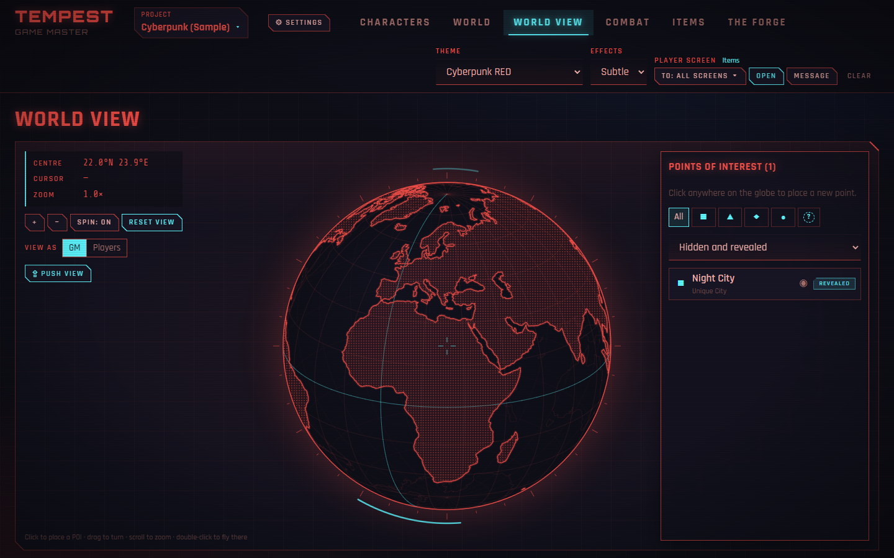
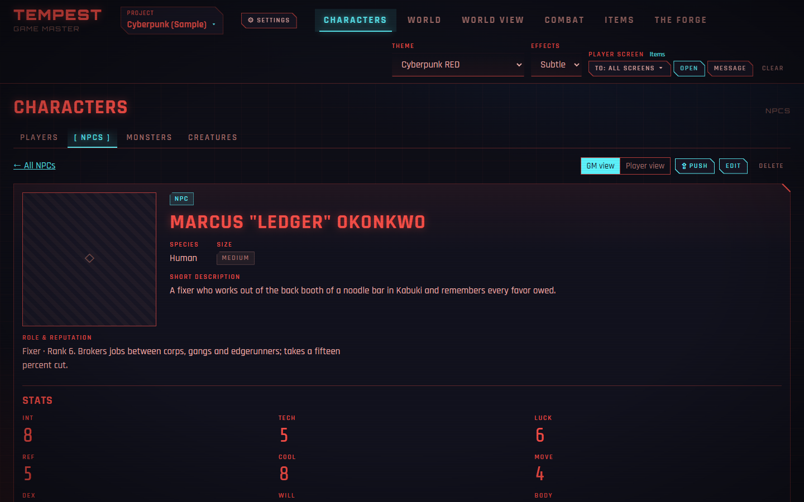
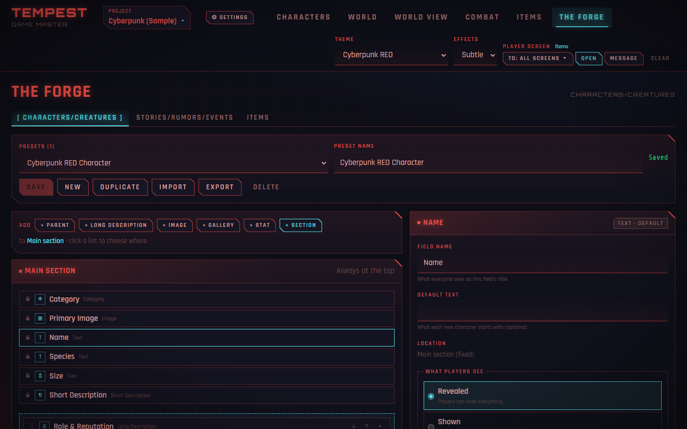
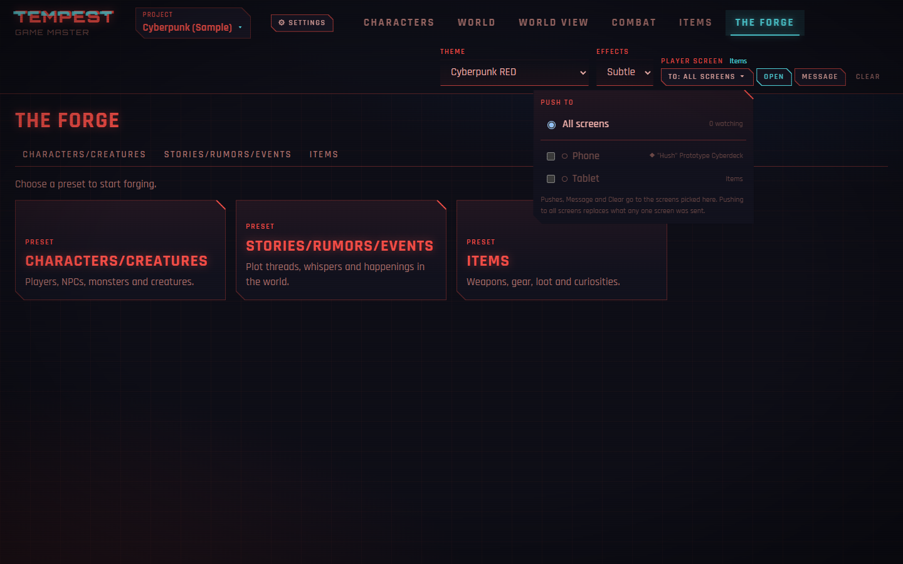
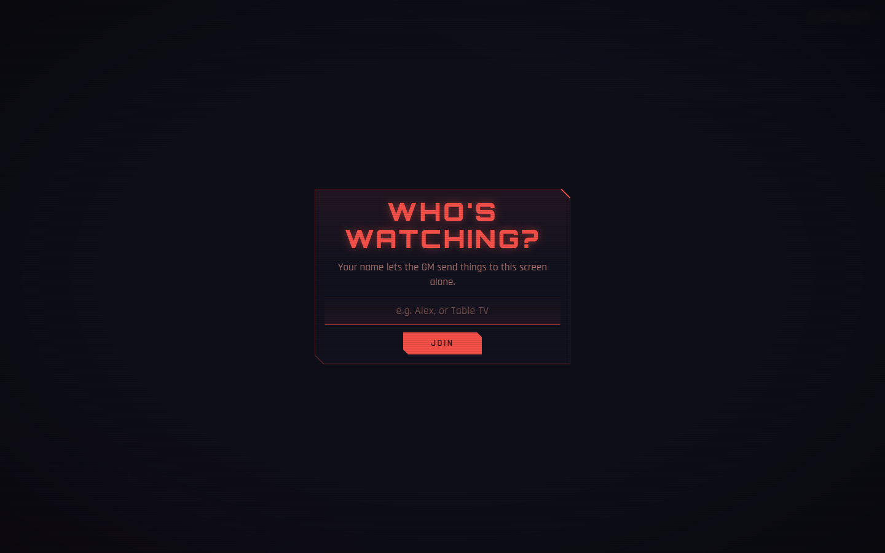
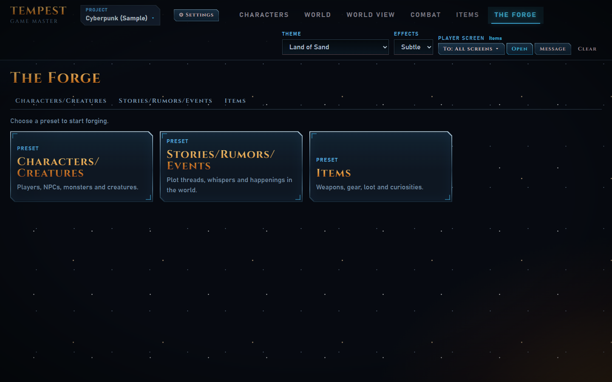
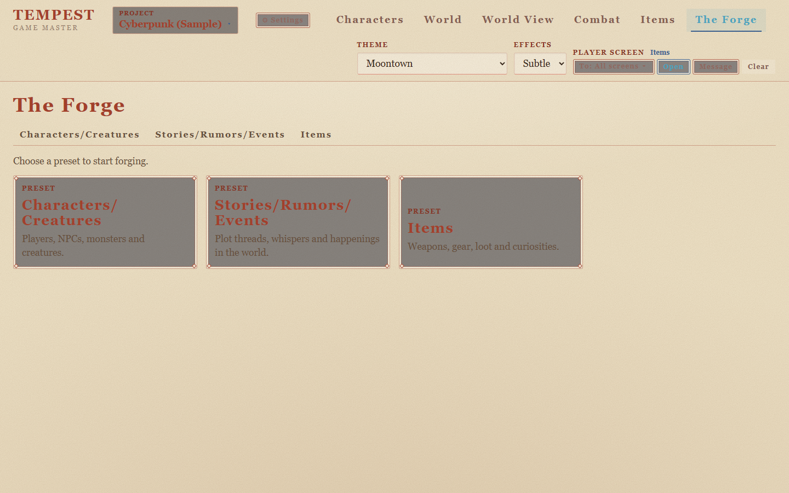

<div align="center">


# TEMPEST

**A local game-master tool for tabletop RPGs.**
Build your characters, world and loot in one window, then push exactly what the players should see to their screens: the table TV, a laptop, or everyone's phones.

[](LICENSE)




</div>

## Why TEMPEST

- **Everything runs on your PC.** A small Node server with **zero npm dependencies** serves the app on `127.0.0.1`. No accounts, no cloud, and your campaigns stay in plain JSON files you can copy and back up.
- **A GM window and player screens.** You prep and run the game in one window. Players see only what you **push**, and the server strips anything they shouldn't see before it leaves your PC.
- **Player screens on any device.** Turn on network sharing and players scan a QR code to open the player screen on their phone, tablet or TV. Each screen has a name, so you can push to everyone or to one player alone.
- **Build your own sheets.** The Forge designs templates (presets) for characters, stories and items, with per-field rules for what players see: **Revealed**, **Shown** (your own player-facing text) or **Rumored** (redacted).
- **Maps.** An interactive holographic 3D globe with points of interest, and a district-aware city map of Night City.
- **Themes that match the game.** Hot-swappable themes restyle the whole tool, player screens included: Cyberpunk RED, Moontown (storybook fantasy), Land of Sand (retro sci-fi), and variants.

| | |
|---|---|
|  |  |
| **Characters:** a sheet built from your preset, with a GM view / Player view switch and **⇪ Push** | **The Forge:** design the sheet, then choose what players see of each field |
|  |  |
| **Push to:** every screen, or only the ones you pick | **Player screens** ask for a name when they open |
|  |  |
| **Themes:** the same page in Land of Sand | **…and in Moontown** |

## Contents

- [Quick start](#quick-start)
- [Configuration](#configuration)
- [User guide](#user-guide)
- [Themes](#themes)
- [Project structure](#project-structure)
- [Development](#development)
- [Project status](#project-status)
- [Third-party content and credits](#third-party-content-and-credits)
- [License](#license)

## Quick start

### Standalone download (no Node.js needed)

Download the archive for your system from the [Releases](https://github.com/Contium/PROJECT-TEMPEST/releases) page and unpack it anywhere:

| System | Archive | Start it with |
|---|---|---|
| Windows 10 / 11 (x64) | `tempest-<version>-win-x64.zip` | Double-click `tempest.exe`. Run `tempest.exe setup` once to add Start Menu shortcuts. |
| Linux (x64) | `tempest-<version>-linux-x64.tar.gz` | `./tempest` |

The binary starts the server in the background and opens the GM window, exactly like the Start Menu shortcut below. Keep it in its folder: the app's files sit next to it. The same commands work from a terminal:

| Command | What it does |
|---|---|
| `tempest` | Starts the server (and, on Windows, the tray icon) if needed, and opens the GM window |
| `tempest --background` | The same, without opening a window |
| `tempest --stop` / `tempest --quit` | Stops the server / stops it and removes the tray icon |
| `tempest serve` | Runs the server in this terminal (Ctrl+C stops it) |
| `tempest setup` | Windows: adds the Start Menu shortcuts (`--autostart` also starts TEMPEST at sign-in) |
| `tempest --version` | Prints the TEMPEST and Node.js versions |

> [!NOTE]
> On Linux the GM window opens in Chrome, Chromium, Edge or Brave as an app window if one is installed, otherwise in your default browser. There is no tray icon on Linux, and the binaries are unsigned, so Windows SmartScreen may ask before the first run (**More info → Run anyway**).

### From source

**Requirements:** [Node.js](https://nodejs.org/) 20 or newer. Windows 10 or 11 for the launcher, tray icon and shortcuts. Nothing needs admin rights, and everything is per-user.

1. Get the code:

   ```bash
   git clone https://github.com/Contium/PROJECT-TEMPEST.git
   ```

2. In its folder, install the Start Menu shortcuts:

   ```bash
   npm run setup
   ```

3. Open **TEMPEST** from the Start Menu.

Launching TEMPEST starts the server in the background if it isn't already running, adds a **tray icon**, and opens a chromeless app window (Edge or Chrome, falling back to your default browser). Closing the window leaves the server running, so reopening is instant.

**To try it without installing anything:**

```bash
npm start
```

Then open <http://127.0.0.1:4077>.

> [!NOTE]
> The server is plain Node, so `npm start` and `npm run launch` also work on macOS and Linux, but only Windows is tested. The tray icon and shortcuts are Windows-only.

### The tray icon

Right-click the TEMPEST icon in the notification area (next to the clock) for:

| Item | What it does |
|---|---|
| Show GM window | Brings an open GM window to the front, or opens one. Double-clicking the icon does the same. |
| Open player screen | Opens the player screen in its own window |
| Restart server | Stops and restarts the server. Shows *Start server* when it's stopped. |
| Start with Windows | Toggles sign-in autostart (server and tray, no window) |
| Quit TEMPEST | Stops the server, closes TEMPEST's windows and removes the icon. The **Quit TEMPEST** Start Menu shortcut does the same. |

### Command line

| Command | What it does |
|---|---|
| `npm run setup` | Adds **TEMPEST** and **Quit TEMPEST** to the Start Menu |
| `npm run setup:autostart` | The same, and starts TEMPEST in the background when you sign in |
| `npm run uninstall-shortcuts` | Removes every TEMPEST shortcut |
| `npm run launch` | Starts the server and tray if needed, and opens the GM window |
| `npm run restart` | Restarts the server |
| `npm run stop` | Stops the server and leaves the tray icon running |
| `npm run quit` | Stops the server and removes the tray icon |
| `npm run icon` | Regenerates `assets/tempest.ico` and `assets/tempest-256.png` |
| `npm start` | Runs the server in this terminal (development) |
| `npm test` | Runs the test suites |
| `npm run build` | Builds the standalone Windows and Linux binaries into `dist/` (see [Building the binaries](#building-the-binaries)) |

The shortcuts store the folder's path and the path to `node.exe`, so run `npm run setup` again if either one moves.

## Configuration

| Environment variable | Default | What it sets |
|---|---|---|
| `TEMPEST_PORT` | `4077` | The GM server's port |
| `TEMPEST_DATA_DIR` | `%LOCALAPPDATA%\TEMPEST` (Linux: `~/.local/share/TEMPEST`) | Where data is kept. Point it at another folder for a test copy that doesn't touch your projects. |
| `TEMPEST_LAN_PORT` | GM port + 1 (`4078`) | The network player screen's port |
| `TEMPEST_LAN_HOST` | `0.0.0.0` | Where the network player screen listens. `127.0.0.1` keeps it off the network while testing. |
| `TEMPEST_NO_TRAY` | unset | Any value skips the tray icon when launching |
| `TEMPEST_NO_DEMO` | unset | Any value stops the server from installing the [demo project](#demo-project) |

**Where things are kept** (on Linux, read `~/.local/share/TEMPEST`, or `$XDG_DATA_HOME/TEMPEST`, for `%LOCALAPPDATA%\TEMPEST`):

| What | Where |
|---|---|
| Projects (one folder each) | `%LOCALAPPDATA%\TEMPEST\v1\projects\<id>\` |
| Deleted projects | `%LOCALAPPDATA%\TEMPEST\v1\trash\` |
| What's on the player screens | `%LOCALAPPDATA%\TEMPEST\v1\display.json` |
| Network sharing settings | `%LOCALAPPDATA%\TEMPEST\v1\lan.json` |
| Imported screamsheet tables | `%LOCALAPPDATA%\TEMPEST\packs\screamsheet\` |
| Logs | `%LOCALAPPDATA%\TEMPEST\logs\server.log` |

**Security:** the GM server listens on `127.0.0.1` only. Requests that change anything must come from TEMPEST's own pages, with the host, origin and content type all checked. `Archived/`, `server/`, `launcher/`, `test/`, `demo/` and dot-folders are never served. The network player screen is a separate, read-only server; see [The player screen on your network](#the-player-screen-on-your-network).

### Demo project

TEMPEST ships with a demo campaign, **Cyberpunk (Sample)**, in `demo/projects/`. The first time the server starts, it copies the demo into your data folder, so a new install opens on a campaign that uses every section:

- **Characters:** the Static Saints, a crew of player characters built on the *Cyberpunk RED: Player Character* template. They come with full STATS, Skills, a cyberware body diagram and Lifepaths, plus their fixer, a ripperdoc, a corporate exec, a gang boss, a cyberpsycho and a sewer-dwelling creature.
- **World:** linked gigs, an event and a rumor, with who's involved, payouts and the GM-only truth. Two screamsheets.
- **Items:** gear from Very Common to Legendary.
- **Maps:** places on the World View globe (one hidden from players), and pins across Night City's districts on the City Map, linked to the people and stories there.
- **Netrunning:** the **Steeltooth Bar** NET architecture, ready to run, and a deck of net cards to build more from: Password, File, Control Node, six Black ICE (Skunk, Liche, Raven, Hellhound, Wisp, Sabertooth) and an Imp Demon, on the three *Cyberpunk RED* net card templates.

The demo installs **once**. Edit it freely: a later start never overwrites it, and if you delete it, it stays deleted. When an update ships more in the demo (like the Netrunning cards), an installed demo gets each new file once, never over one of yours, and never again after you delete it. `<data>\v1\demo.json` records what was installed and offered. To get the whole demo back, delete that file and the project, then restart. Set `TEMPEST_NO_DEMO=1` to skip it. The standalone binaries include it too.

**Rebuilding the demo:** `scripts/build-demo.mjs` seeds a project through a running server's API, skipping anything that already exists by name. Copy the result into `demo/projects/<id>/` (leave out any `*.tmp` files). `scripts/build-netrun-demo.mjs` writes the Netrunning part (presets, cards and the Steeltooth Bar) straight into the demo folder. `test/demo.test.mjs` checks every shipped file against the app's rules and checks that every link and image resolves.

> [!WARNING]
> **Projects missing?** On Windows, an app installed as a package (MSIX) gets a private copy of `AppData`. A TEMPEST server *started by* such an app, for example a coding assistant's desktop app or its terminal, saves into `%LOCALAPPDATA%\Packages\<that app>\LocalCache\Local\TEMPEST` instead of `%LOCALAPPDATA%\TEMPEST`. The TEMPEST you start yourself can't see that copy. Start TEMPEST from its Start Menu shortcut or your own terminal. To rescue projects saved there, copy their folders from `…\LocalCache\Local\TEMPEST\v1\projects\` into `%LOCALAPPDATA%\TEMPEST\v1\projects\` with File Explorer.

## User guide

### Projects

Everything you make (presets, characters, stories, items and their images) belongs to a **project**, and projects never see each other's data. Use one per campaign or setting.

- **Choosing a project:** the first time you open TEMPEST, or whenever no project is open, it starts on the **project picker** (`#/projects`). After that, each window reopens the project it last used. The **Project** button at the top left shows the open project and returns to the picker at any time. The sections in the top bar appear once a project is open.
- **In the picker:**
  - **Create** a project with a name, an optional description and a theme. It opens straight away.
  - **Open** a project, or **Continue** with the one already open. Projects are listed most recently opened first, with their character and preset counts.
  - **Rename** changes a project's name, description and theme.
  - **Delete** asks first, then moves the project's folder to `%LOCALAPPDATA%\TEMPEST\v1\trash\` rather than erasing it. To bring one back, move its folder into `v1\projects\` and remove the date from the end of its name.
- **Themes:** each project remembers its theme. Changing the theme in the top bar saves it to the open project, and switching projects switches the look.
- **Per-project memory:** the designer's draft, the last preset opened and each section's last tab are remembered separately for each project.
- **Storage:** a project is one folder, `%LOCALAPPDATA%\TEMPEST\v1\projects\<id>\`, holding `project.json` and folders for its presets, entries and images. Back one up, or move it to another PC, by copying that folder.

#### Project settings

Open them from the **⚙ Settings** button next to the Project button (`#/settings`), or from a project's card in the picker. Changes are drafted on the page and saved together with **Save settings**. **Discard changes** undoes them, and leaving with unsaved changes asks first.

**Money:**

| Mode | What it is |
|---|---|
| **D&D style** (default) | Copper, Silver, Electrum, Gold and Platinum, worth 1 / 10 / 50 / 100 / 1000 copper |
| **Single currency** | One currency with your own name and symbol, e.g. *Eurodollar* and `§`, with the symbol before (`§ 1,250`) or after (`1,250 §`) the amount |
| **Other** | Up to six currencies, each with a name, a symbol and its value in terms of the first (the base). ▲/▼ reorder them, and moving one to the top makes it the base. |

- **Preview:** a box shows how an amount reads in the chosen money (`12 pp 3 gp 4 sp 5 cp`, `§ 1,250`, `85 bar 8 sc 9 ch`) and each currency's rate against the base.
- **Breaking amounts down:** amounts with several currencies are broken into the largest ones first, skipping any that come out empty. Electrum is left out of D&D breakdowns, as most tables do.
- **Switching modes:** each mode keeps its own setup, so switching modes and back loses nothing.
- **Invalid setups:** an empty name, or a value of 0 or less, shows what's wrong and blocks Save.

**Map system:** **Planar**, **Planetary**, **Cartographer** or **Galactic**, or *Decide later* (the default). **Planetary** is built: choosing it adds the **World View** section. With Planetary or Galactic chosen, a **Unique locations** block switches the built-in **Night City** on or off. The other systems are still to come; choosing one now records how this project's maps will work.

**Player screen on your network:** see [below](#the-player-screen-on-your-network).

### Sections

The GM window has these sections, shown as tabs across the top bar:

| Section | Tabs |
|---|---|
| **Characters** | Players · NPCs · Monsters · Creatures |
| **World** | Events · Stories · Rumors · Screamsheets · Timeline |
| **World View** | Only with Planetary maps: the 3D globe |
| **Combat** | Netrunning (Network Builder · Card Forge · Networks) |
| **Items** | One list, filtered by rarity |
| **The Forge** | Presets: Characters/Creatures · Stories/Rumors/Events · Items |

- **The Forge** is where new things are made from presets. It opens on a chooser with one card per preset type.
- **Addresses:** each tab has its own, for example `#/characters/npcs`, `#/world/stories`, `#/items/<id>` or `#/forge/characters`. Each section remembers the tab you were last on.
- **Player screen** (`#/player`): **Open** in the top bar, or *Open player screen* on the tray icon, opens it in its own window.

### Character presets (The Forge)

A **preset** is your own template for a character sheet: which fields it has, where they sit, and what players get to see of each. It holds the structure and default values. Images belong to characters, so presets have image *slots* but no pictures.

Under the preset toolbar, three tabs split the page, and the last one used is remembered:

| Tab | What's on it |
|---|---|
| **Create New** (the default) | The form for a new character from the open preset, with the sheet beside it, updating as you type and staying in view as you scroll |
| **Design** | The builder (main section, sections, *Add* bar) and the field settings |
| **Preview** | The whole sheet at full width, as the GM or the players see it |

**Long presets fold:** a preset with more than five sections opens with them folded, in the builder and in the form. In the builder, ▸/▾ (or the field count) folds and unfolds a section, and **Fold all** / **Unfold all** do every one. In the form, click a section's name, or use **Open all sections** / **Close all**. Moving a field into a folded section unfolds it.

**Default fields** sit at the top of the main section, in a fixed order, and can't be removed or moved:

| Field | |
|---|---|
| Category | Player · NPC · Monster · Creature. Always set (NPC unless the preset picks another); it decides which Characters tab a character goes in |
| Primary Image | Square (1:1), top left of the sheet |
| Name | |
| Species | |
| Size | Miniscule · Nano · Tiny · Small · Medium · Large · Giant · Gargantuan · Colossal (default Medium) |
| Short Description | |

**Fields you can add** (the *Add* bar), each with its own name:

| Field | Options |
|---|---|
| Parent | Parent type: Character, Monster, Creature, Story/Event, Item or Anything |
| Long Description | A named block of text |
| Image | Field description |
| Gallery | Field description, and a type: **Floors** (▲/▼ one image at a time), **Slideshow** (◀/▶, optionally cycling every N seconds and pausing on hover) or **Grid** (1×1 up to 3×3) |
| Stat | **Pool** (a bar with a value and a limit), **Fixed number**, **Flexible pool** (a bar that can go past its limit, the overflow striped), or **Rarity** (your own list of rarities, each with a name, colour and style: Plain, Outline, Glow or Shimmer) |

**Layout:**
- **Placement:** fields go in the **main section**, under the defaults, or in **Sections** below it. Each section has a title and 1, 2 or 3 columns.
- **Where new fields go:** *Add* puts them in whichever list you last clicked; the *Add* bar names it.
- **Moving fields:** drag them between lists, use ▲/▼, or set *Location* in the field's settings.
- **Sections** can be reordered or removed. Removing one removes its fields, after asking. Reducing the column count moves fields from the dropped columns into the last remaining one.
- **Body diagram:** set a section's **Layout** to *Body diagram* for cyberware, wounds or armor by body part. A figure (`app/forge/art/body-figure.webp`) sits behind the section, and its fields are boxes in front of it, with leader lines, in five zones: *Above the head*, *Left of the figure*, *Right of the figure*, *Over the hips*, and *Beside the figure* (a list to the right). On narrow screens the figure shrinks to a banner and the boxes stack. Switching back to *Columns* keeps every field. On light themes the figure is drawn as ink.

**Each field's settings** (click it):
- **Name**, its **type options** and a **default value**.
- **Location:** the main section, or a section and column.
- **What players see:**
  - **Revealed:** everything.
  - **Shown:** players read text you write for them instead of the real contents.
  - **Rumored:** players see the field's name, with the contents obscured as redacted bars, static or your own text.
- **References:** GM only. Marks the field as carrying links to other entries for quick access.

The sheet (on the **Create New** and **Preview** tabs) is drawn as the GM sees it (Shown and Rumored fields marked) or as players will: switch with **GM view** / **Player view**.

#### Templates

**New from template…**, next to **New**, starts an unsaved preset from a ready-made one. Once open it is an ordinary preset: change anything, then **Save** it.

| Template | What's in it |
|---|---|
| **Cyberpunk RED: Player Character** | The official character sheet (R. Talsorian Games), page by page, in 123 fields. The **Handle**, a **Role** picked from the ten Roles, each named with its Role Ability, the Role Ability Rank (default 4) and the ability's text. The ten **STATS**; LUCK and EMP are pools, as they're spent or lost in play. **Hit Points**, Seriously Wounded, Death Save, **Humanity**, Critical Injuries and Addictions. All **66 Skills** in their nine groups, each labelled with its STAT, and ×2 for those that cost double. **Weapons & Armor**, **Cyberware** as a body diagram like the sheet's skeleton page (each eye, arm and leg, the Cyberaudio Suite and Neural Link around the figure; internal, external, fashionware and borgware beside it), **Gear** (ammunition, cash, lifestyle and housing), **Reputation** (aliases, events, Improvement Points) and the whole **Lifepath**. |

- **Numbers the rules derive** (Hit Points = 10 + 5 × (BODY + WILL) ÷ 2 rounded up, Seriously Wounded = half of that rounded up, Death Save = BODY, Humanity = EMP × 10) are fields you fill in.
- **Defaults:** every STAT starts at 5 and the derived numbers match that (35 HP, 18, 5, 50 Humanity). Skills start at 0 and are entered as Skill Levels: add the STAT for a check.

**Saving and sharing:**
- **Save** (or Ctrl+S) stores the preset in the project.
- **New**, **Duplicate** and **Delete** do what they say. Delete, and switching away from unsaved changes, ask first.
- **Export** saves a `.tempest-preset.json` file to share or back up. **Import** loads one. An imported preset always gets a fresh id, so it never overwrites another, and broken or foreign files are refused with the reason.
- **Drafts:** unsaved work is kept in the browser as a draft, so reloading or closing the window loses nothing.
- The server checks every save and import with the same rules the designer uses.

#### Create New

The **Create New** tab is a form built from the preset, so making a character takes one page:

1. Build or open a preset.
2. On the **Create New** tab, fill in the form. Fields you haven't touched follow the preset's defaults as you change them, and the sheet beside the form shows the character as you go.
3. Click **Create New**.

The character is saved and filed under **Characters** by its Category. A notice links straight to it, and the form clears for the next one.

- **Images:** pick one for each Image field, or several for a Gallery, with a label each. Large photos are scaled to 1600 px and saved as WebP before upload.
- **Parent:** pick from existing entries of the right kind.
- **Shown fields** get a *Players read* box for what players know about *this* character.
- **Fields with References** get a GM-only list for linking other entries.

A character keeps a **snapshot** of the preset it came from, so editing or deleting the preset later never changes or breaks it.

### Characters

- **Tabs:** Players, NPCs, Monsters and Creatures each list their characters as cards (portrait, name, species and size, short description, source preset). An empty tab points to The Forge.
- **Character pages** (`#/characters/<tab>/<id>`) show the sheet with a **GM view / Player view** switch. Parents and references link to other entries.
- **Edit** reuses the Create New form, with the sheet updating live. Changing Category moves the character to the matching tab. **Delete** asks first.
- **Images** are stored in the project's `assets\` folder, named by their content, so a picture used twice is stored once. Uploads must really be PNG, JPEG, GIF or WebP (checked by their bytes), and 10 MB at most.

### Stories, rumors and events

The second kind of preset, made in **The Forge › Stories/Rumors/Events**. It works exactly like character presets; what differs is below.

**Default fields:**

| Field | |
|---|---|
| Type | Story · Rumor · Event (default Event); it decides which World tab the entry goes in |
| Primary Image | Square (1:1) |
| Title | Required |
| Start | An in-world date: year, month, day and an optional time |
| End | The same. Left empty, the entry shows as *Ongoing* |
| Short Description | |

Dates suit any calendar: years can be negative (before your setting's epoch), months and days go up to 99, and a year alone, or a year and month, is fine.

**Extra fields:**

| Field | Types |
|---|---|
| **Characters** | **Combat:** 1–3 sides of a conflict, each with a faction and its fighters. **Involved:** the characters who take part, each with an optional note. |
| **Location** | **Indirect:** links any entry that stands for the place. **Obscure:** an empty picture frame and a short description of your own. **Direct:** links a Location entry (once Locations exist). |

**World › Events / Stories / Rumors** list what you've made by Type, as cards in date order showing *start – end* (or *ongoing*). Each entry has its own page at `#/world/<tab>/<id>` with **GM view / Player view**, links, **Edit** and **Delete**.

### Screamsheets

In-world news articles, made with the **Screamsheet Generator** and kept under **World › Screamsheets**.

- **The list** shows every screamsheet, newest first, with its outlet, date line, a snippet, Hidden/Revealed and **⇪ Push**. **⚄ New screamsheet** opens the generator.
- **The generator** follows the five steps of R. Talsorian's free *Screamsheet Generator* for Cyberpunk RED, with a live preview:
  1. **Type of article:** pick one, or roll.
  2. **Content:** pick or reroll the intro, body and conclusion.
  3. **Headline:** one of those the conclusion suggests.
  4. **Fill in the details:** every [blank] gets a box. People suggest your project's characters; places suggest Night City's districts and your points of interest. **⚄ Fill blanks from the project** fills every empty one it can.
  5. **Polish & publish:** outlet, byline, date line, layout (**Broadsheet**, **Terminal** or **Plain**) and **Hidden/Revealed**. You can also edit the text by hand. **⇪ Save & push to players** saves it revealed and puts it on the player screens.
- **Players** only ever get revealed screamsheets, as printed: never the generator's picks or which entries it mentions.

> [!IMPORTANT]
> **Import the tables once before first use.** The generator's tables are R. Talsorian Games' text, so TEMPEST reads them from the free *Screamsheet Generator* PDF (a copy is in `assets/cyberpunkRED/`) instead of storing them in its code. Until you import them, the generator offers to. Importing needs Python 3 with `pypdf`:
>
> ```bash
> python scripts/import_screamsheet.py "assets/cyberpunkRED/RTG-CPR-DLC-ScreamsheetGenerator.pdf" "%LOCALAPPDATA%\TEMPEST\packs\screamsheet"
> ```

### Items

The third kind of preset, made in **The Forge › Items**.

**Default fields:** Primary Image, Name (required), Item Type (free text: Weapon, Armor, Cyberware, Potion…), Rarity and Short Description.

**Rarity** starts with nine, rising in colour and style. Each preset can rename, recolour, restyle, add or remove them:

| Rarity | Colour | Style |
|---|---|---|
| Very Common | `#8A8F98` grey | Plain |
| Common | `#C8CCD2` silver | Plain |
| Uncommon | `#3FBF7F` green | Outline |
| Rare | `#4F8CFF` blue | Outline |
| Super Rare | `#22C3D6` cyan | Glow |
| Exotic | `#E0569A` pink | Glow |
| Legendary | `#F5B041` gold | Shimmer |
| Fabled | `#A259FF` violet | Shimmer |
| Mythic | `#FF4D4D` red | Shimmer |

The **Items** section is a single list of everything you've made (`#/items`), as cards with the item type and a rarity badge. When more than one rarity is in use, chips across the top filter by rarity. Each item has its own page at `#/items/<id>`.

### Stat Blocks

A field type for characters, items and net cards: a row of named stats read together, as a rulebook prints them (`PER · SPD · ATK · DEF · REZ`, or `STR · DEX · CON …`).

- **In the designer:** add **Stat Block**, then name its stats (1 to 12), reorder them with ← →, and give any of them a default.
- **Values** are short text (up to 12 characters), so `4`, `3d6` and `—` all fit.
- **On the sheet** it's a small table: the names across the top, the values beneath.

### Netrunning (Combat)

**Combat › Netrunning** builds NET architectures out of cards and reveals them to the players floor by floor. It has three sub-tabs:

| Sub-tab | Address | What it's for |
|---|---|---|
| **Network Builder** | `#/combat/netrunning/builder` | Put net cards together into a network |
| **Card Forge** | `#/combat/netrunning/cards` | Design net cards and make them |
| **Networks** | `#/combat/netrunning/networks` | Your saved networks: run one and reveal it |

**Card Forge.** The fourth kind of preset, with the same designer as The Forge (Create New · Design · Preview).
- **Default fields:** Type (Password, File, Control Node, Black ICE, Demon or Other), Primary Image, Name, DV and Short Description. Add Long Descriptions, Images, Galleries, Stats and **Stat Blocks**.
- **Templates** (**New from template**): *Cyberpunk RED: Black ICE* (Class, then PER · SPD · ATK · DEF · REZ, then Effect), *Demon* (REZ · Interface · NET Actions · Combat #) and *Password, File or Control Node* (what it does, its contents, kept Rumored, and what it controls).
- **Your net cards:** the list above the designer. Open a card (`#/combat/netrunning/<card id>`) to edit it, push it to the players or delete it.

**Network Builder.**
- **Palette:** your net cards, searchable and filtered by type, on the left.
- **Adding:** click a card to add it below the selected node; the new node becomes the selection, so clicking card after card builds a line straight down. With nothing selected, the card starts a new branch at the top. You can also drag a card onto any node to hang it there.
- **Branches:** select the node to branch from and click another card. Two branches merge when a node **comes after** both: pick *+ Also comes after…* in its settings, like the Hellhounds that guard the bottom of the Steeltooth Bar.
- **Node settings:** its card, a **Label** players read instead of the card's name (*Control Node (Cameras)*), its **DV** here, **How many** (*Hellhound ×2*) and a **GM note**.
- **Rearranging:** move a branch left or right, add an empty slot above or below, remove a node (what hung below it moves up) or a whole branch.
- **Layout:** the map lays itself out as the rulebook draws architectures: chamfered boxes in rows, a single line straight down, each node centred over its branches, and merged nodes below every branch that leads to them.
- **Saving:** **Save** (Ctrl+S). Unsaved work is kept as a draft in the browser. Delete removes the selected node and Esc lets go of it.

**Networks.** Open a network to run it. You see the whole architecture, with hidden nodes dimmed.
- **Revealing:** **Reveal next** reveals the next node down the architecture, top to bottom. Click any node to reveal or hide just that one, read its GM note, and see its card's full sheet. **Reveal all** and **Hide all** do every node at once.
- **Update the player screen as I reveal** (on by default): every reveal goes straight to the player screens, with the new node lit and its card beside the map, as the card's own sheet allows.
- **Show the way ahead:** players also see a blank box for each hidden node at the top or right below a revealed one.
- **Player view** previews exactly what the players get. **⇪ Push network** and **⇪ Push, lit** push by hand.
- **What players never get:** hidden nodes (not even their names or how many there are, unless *Show the way ahead* is on), GM notes, and Rumored fields of a card.

### World View (Planetary maps)

With the project's map system set to **Planetary**, a **World View** section appears (`#/worldview`). It shows an **interactive 3D Earth** drawn as holographic line art in the theme's colours.

- **Controls:** drag to turn it (it coasts briefly when let go), scroll or pinch to zoom (0.6×–6×), double-click to fly to a spot. Keys: ←↑→↓ turn, + and − zoom, Space toggles the slow spin, 0 resets.
- **Readouts:** the centre point, the point under the cursor, and the zoom.
- **Motion:** effects *Off* drops the glow, scanlines and scan arc. Windows' reduced-motion setting also stops the automatic spin.
- **Offline:** the coastlines are Natural Earth's public-domain outlines, kept in the repository, and the globe is drawn on a plain canvas by TEMPEST's own code, with no 3D library.

#### Points of interest

**Click** anywhere on the globe to place a point of interest. The panel asks for:

- **Name** and **Type**, each with its own marker: City (square), Landmark (triangle), Point of Interest (diamond), Other (dot) or Unknown (a dashed **?**)
- **Description** (optional)
- **Players: Hidden / Revealed.** New points start **Hidden**: only you see them until you reveal them.
- **Maps & pictures** (optional): up to 12 images, each with a caption. Players see a revealed point's maps.

**Working with points:**
- **Click a marker** (or a name in the list) to fly to it and edit it: rename it, change its type or description, **Hide/Reveal**, **Move** or **Delete** it.
- **The list** shows every point with its type and visibility. **◉/◌** on each row reveals or hides it at once. Filter by type and by visibility.
- **View as: GM / Players** shows the globe as players would see it: only revealed points, look-only.
- **⇪ Push view** and **⇪ Push** send the globe, or one point, to the player screens.

#### Night City

Projects using Planetary (or Galactic) maps get **Night City**, a built-in unique city at 35.3658° N, 120.8499° W. It's on and **Revealed** by default, since the city is common knowledge. It can't be moved, renamed or deleted; its panel offers **Hidden / Revealed**, **Fly to** and **Open City Map**. Turn it off in **Project settings › Unique locations**.

#### City Map

Night City's map (`#/worldview/nightcity`) is R. Talsorian's free **Night City 2045 Atlas**, with its 25 districts laid over it as outlines.

- **Hover** a district to light it up and see its name; **click** it to select it. The selected district opens in the side panel with its share of the city, **Zoom to**, **Whole city** and **‹ Prev / Next ›**.
- **The side panel** lists every district, with a search box.
- **Moving around:** drag to pan, scroll or double-click to zoom, **+ / −**, **Fit**. Arrow keys, + and −, and 0 work when the map has focus.
- **Layers:** **Districts**, **Streets**, **Locations** or **Full**, the atlas's four sheets. **Outlines: on/off** shows or hides every district's edge.

**City points of interest:**
- **Placing:** press **+ Place POI** and click the map, or **Shift+click** anywhere. The new point is filed under the district it lands in, detected from the traced outlines.
- **Icons:** twelve to choose from: Point of interest, Landmark, Bar / club, Shop / market, Clinic / ripperdoc, Gang turf, Corporate, Safehouse / home, Contact / fixer, Net / data, Police / security and Danger.
- **Players:** every point is **Hidden** until you **Reveal** it.
- **References** (GM only): attach characters, events, stories, rumors and items from the project, each with an optional note.
- **Maps & pictures:** up to 12 images, such as floor plans, each with a caption.
- **View as Players** shows only revealed points, and never your references.

The district outlines (`assets/maps/nightcity/districts.json`) were traced from the atlas by `scripts/extract-districts.py` (needs numpy). It finds the red dotted borders, flood-fills each district from its label, and grows the districts back over the borders until neighbours meet. A few borders the dots don't close are drawn in by hand in the script. To redo the tracing from a 3300 × 5100 24-bit BMP of the "w District Names" sheet:

```bash
python scripts/extract-districts.py half.bmp assets/maps/nightcity/districts.json preview.bmp
```

### Pushing to the player screen

You push what players should see, and every player screen shows it at once, live. It stays up until the next push or **Clear**, and survives a restart.

**The top bar's Player screen control** shows what every screen shows and how many are watching, and has:
- **To ▾:** who pushes go to. **All screens** by default.
- **Open:** a player screen window on this PC
- **Message:** an announcement with an optional heading. The tone is Info, Good news, Warning or **Alert**, which flashes.
- **Clear:** back to *Standing by*

**What you can push, and from where:**

| From | Button | The players see |
|---|---|---|
| An entry's page (characters, events, stories, rumors, items) | **⇪ Push** | Its sheet exactly as **Player view** shows it |
| Any of those lists | **⇪ Push list** | A card for every entry on the tab: name, picture and summary, each only as that entry's sheet allows |
| A picture on a sheet (hover it) | **⇪ Push** | That picture, full screen |
| Any picture in the **image viewer** | **⇪ Push to players** | That picture, full screen |
| A screamsheet | **⇪ Push** | The article as printed |
| World View | **⇪ Push view** | The globe as you've turned it, with the revealed points |
| A World View point | **⇪ Push** | The point's name, type, description and maps |
| The City Map | **⇪ Push map** | The city map on the current layer, the selected district lit, with the revealed points |
| A district | **⇪ Push district** | That district lit and framed |
| A city point | **⇪ Push** | Its icon, name, district, description and maps |
| A network (Combat › Netrunning › Networks) | **⇪ Push network**, or each reveal with *Update the player screen* on | Its revealed nodes as a map, one lit, with that node's card beside it |

**Named screens:**
- Every time a player screen opens (the network link or QR code, a reload, or **Open**), it asks **Who's watching?** The last name used on that device is filled in, so Enter keeps it. Tap the name in the screen's corner to change it.
- **To ▾** lists the named screens, with a green dot for those watching now and what each one shows (◆ marks something sent to that screen alone).
- Pick **All screens**, or tick one or more names. Every push button, **Message** and **Clear** then goes to those screens, and the confirmation says who got it (*On screen for Sam: …*).
- A screen keeps what it was sent until the next push that reaches it. Pushing to **All screens** replaces anything sent to a single screen, so everyone sees the same again.
- Capitals don't matter (*sam* is *Sam*). Two devices with the same name share a screen, which suits a table TV.
- Each GM window starts on **All screens**, and remembers your pick only while it's open.

**What players get:**
- **The server builds it.** A push only names what to show; the server reads it from the project and keeps what players may see: Revealed fields, Shown fields' player text, nothing of Rumored fields, and never references. Linked entries show by name only if their own Name field is Revealed.
- **Hidden things stay hidden.** Pushing a hidden point or screamsheet asks to reveal it first; the server refuses a hidden one otherwise.
- A push shows what's saved, so save edits before pushing.

**Looks:** each player screen switches to your theme with each push, and pushes play the theme's entrance: Cyberpunk RED glitches in, Moontown unfurls, Land of Sand resolves through an uplink. Effects *Off* and reduced motion use a short fade.

**Full screen:** **⤢ Full screen** in the player screen's top-right corner (or press **F**). The controls and cursor fade away when the pointer rests. iPhones can't fill the screen from a web page; there, the button explains how to add the player screen to the Home Screen instead.

**Updates:** after you update TEMPEST, open player screens reload themselves on your next push, keeping their names.

### The player screen on your network

Players can open the player screen in any browser on the same network: phones, tablets, laptops, smart TVs. Turn it on in **Project settings › Player screen on your network**:

1. Tick **Share the player screen on this network**. A second, read-only server starts on port **4078**.
2. Players scan the **QR code** or open the link. **Show large** fills the screen with the code for scanning across the table, and **Copy link** copies it for chat.
3. The link opens the player screen, asks **Who's watching?**, and remembers the device for 30 days.

- **Several networks:** if the PC is on more than one network (Wi-Fi, a VPN), pick which address the code uses.
- **Firewall:** the first time sharing starts, Windows may ask whether Node.js can use the network. Allow it on **private** networks, or other devices can't connect.
- **Fonts:** the themes load fonts from Google Fonts, so a device without internet access shows fallback fonts.

**What the network can reach:**
- **Only with the link's key.** Opening the address without it shows a page asking for the GM's link.
- **New link** changes the key and disconnects every device using the old one.
- **Read-only, and only the player screen:** its page, scripts, themes and built-in maps, what's on screen, and the pictures in what's on a screen now. No projects, entries, presets, settings or other pictures, no list of who else is watching, and no writes.
- **Turning sharing off** stops the network server. The setting is remembered across restarts.

### The image viewer

Click any picture (sheet images, gallery pictures, maps attached to points) to open it full size.

- **Moving around:** scroll (or **+ / −**) zooms about the cursor, drag pans, double-click toggles between fitting the window and 2×, and **Fit** or **0** fits it again.
- **Sets:** a gallery or a point's maps open as a set. **◀ ▶** or the arrow keys step through them.
- **⇪ Push to players** (GM window only) shows the current picture full screen on the player screens.
- **Esc** or **×** closes it.

## Themes

TEMPEST's look comes from a hot-swappable theme library. The theme applies to the GM window and every player screen.

| Theme | Style |
|---|---|
| **Cyberpunk RED** (default) | Neo-Militarism HUD: red structure, cyan for anything interactive, on darkest blue. Chamfered frames, glitch headlines, scanlines. |
| **Cyberpunk RED · Neo-Kitsch** | Corporate luxury: holo magenta and gold on velvet, pill shapes, foil headings, a sheen instead of scanlines |
| **Moontown** | Storybook fantasy, and a **light** theme: parchment, rust and dusty blue, Cinzel and EB Garamond, print grain |
| **Moontown · Shadow Village** | Moontown's shapes and type on obsidian, with mauve frames and arcane violet |
| **Land of Sand** | Early-2000s RTS: gunmetal command panels over a starfield, sand-gold titles, steel bevels and cyan selection brackets |
| **Standard** | A neutral starting point for your own themes |

**Effects** (top bar) set how much each theme animates: **Off**, **Subtle** (default) or **Full**. Every animation respects the system's reduced-motion setting.

### Making a theme

- **Installing a theme** means dropping a folder into `themes/`. The server finds it automatically. Folders whose names start with `_` are shared infrastructure.
- **Authoring:** copy `themes/standard/`, change the `id` in both files, and override any `--tp-*` tokens (the full contract is `themes/_base/tokens.css`). Only add component rules for flavour that tokens can't express.
- **Variants:** a theme whose manifest says `"extends": "<parent id>"` loads its parent's stylesheet first and layers its own on top. While a variant is active, `data-theme` stays the parent id and `data-variant` holds the variant id.
- **Hot-swapping:** `engine.apply(id)` loads the new stylesheet and fonts *before* it flips `data-theme`, so nothing renders unstyled, then tells other open TEMPEST windows.
- **Lexicon:** each theme can rename core terms (in Cyberpunk RED, `currency` becomes "Eurobucks"). Mark text with `data-lex="key"` or call `engine.t('key')`.
- **Push animations:** the player screen's viewport carries `data-push-kind` (`entity`, `roster`, `handout`, `message`, `map`) and `--push-depth`, and is `.is-entering` while a push plays.
- **Style guide:** `styleguide/` is a living style guide with a theme switcher (Ctrl+Alt+T cycles themes).

## Project structure

```text
app/                The GM window and player screen (one page; #/player is the player screen)
  forge/            Presets, the designer, sheets and entries
  maps/             World View globe, City Map, points of interest
  netrun/           Combat › Netrunning: Network Builder, Card Forge, Networks, the architecture map
  push/             Pushing, the player screen, full screen
  screamsheets/     The screamsheet generator and articles
  projects/         Project picker, settings, network sharing card
  vendor/           Third-party files kept in the repository, with sources and licences
server/             The local server (no dependencies): static files, the API, the network player screen
launcher/           Launcher, Windows tray icon and shortcut installer, the standalone binary's entry point
scripts/            Binary builder, icon generator, Night City district tracer, screamsheet table importer
src/theme-engine/   ThemeEngine: load, hot-swap, persist, lexicon
themes/             The theme library (_base holds the token contract and shared components)
styleguide/         Living style guide
assets/             Icons, the built-in map images, and Cyberpunk RED reference files (see credits)
docs/screenshots/   The pictures in this README
test/               node:test suites
Archived/v0/        Version zero, kept for reference and never served
```

## Development

```bash
npm start
```

```bash
npm test
```

- **No build step and no dependencies.** The server is plain Node (`node:http`), and the app is native ES modules loaded straight from `app/`. Edit a file and reload.
- **Shared rules:** the models in `app/` (for example `app/forge/preset-model.js` and `app/push/push-model.js`) are imported by both the browser and the server, so a save is checked by the same rules the UI uses.
- **Tests** use Node's built-in test runner. Most suites run against a throwaway data folder, so they never touch your projects.
- **A separate test server:** set `TEMPEST_DATA_DIR` to an empty folder and `TEMPEST_PORT` to a free port, so it doesn't touch your projects.

**Where to look:**

| Area | Code | Tests |
|---|---|---|
| Projects and settings | `server/projects.js`, `app/projects/` | `test/projects.test.js`, `test/settings.test.js` |
| Presets and entries | `app/forge/`, `server/presets.js`, `server/entities.js`, `server/assets.js` | `test/preset-model.test.mjs`, `test/characters.test.js`, `test/stories.test.js`, `test/items.test.js` |
| Preset templates | `app/forge/templates/` | `test/preset-templates.test.mjs` |
| Globe and points | `app/maps/globe-math.js`, `app/maps/globe.js`, `app/maps/world-view.js`, `server/pois.js` | `test/globe-math.test.mjs`, `test/pois.test.js` |
| City Map | `app/maps/city-map.js`, `app/maps/city-map-model.js`, `app/maps/city-poi-model.js` | `test/city-map.test.mjs`, `test/city-pois.test.js` |
| Pushing and player screens | `app/push/`, `server/display.js` | `test/push.test.js` |
| Network player screen | `server/lan.js`, `app/projects/network.js` | `test/lan.test.js` |
| Screamsheets | `app/screamsheets/`, `server/packs.js` | `test/screamsheets.test.js` |
| Netrunning (net cards, Stat Blocks, networks) | `app/netrun/`, `app/forge/templates/cyberpunk-red-net.js`, `server/pois.js` (store) | `test/netrun.test.js` |
| Demo project | `server/demo.js`, `demo/`, `scripts/build-demo.mjs`, `scripts/build-netrun-demo.mjs` | `test/demo.test.mjs` |
| Sections and routing | `app/sections.js`, `app/main.js` | `test/sections.test.mjs` |

### Building the binaries

```bash
npm run build
```

This makes `dist/tempest-<version>-win-x64.zip` and `dist/tempest-<version>-linux-x64.tar.gz` (add `--targets=linux-arm64`, or any comma-separated list of `win-x64`, `linux-x64` and `linux-arm64`, after `npm run build --` for others). Each holds a `tempest` binary and the app's files beside it.

- **How it works:** the binary is the official Node.js runtime, the same version as the Node that runs the build, downloaded from nodejs.org and checked against its published SHA-256 list. `launcher/binary.js` is injected into it as a Node [single executable application](https://nodejs.org/api/single-executable-applications.html). It loads the server and launcher from the folder next to the binary, so they run exactly as they do from a checkout.
- **What ships:** `app/`, `server/`, `src/`, `themes/`, `launcher/`, the map images and icons, the screamsheet importer, `LICENSE` and this README. The Atlas, the rulebook PDFs, tests, docs and `Archived/` stay out.
- **Build tools:** the one tool, [postject](https://github.com/nodejs/postject) (from the Node.js project), is installed into `.build-cache/` on the first build. On Windows, `scripts/set-exe-icon.ps1` gives `tempest.exe` the TEMPEST icon using Windows' own resource API, and the exe is marked as a windowed app so starting it never flashes a console.
- Both platforms build from either Windows or Linux. Only a Windows build sets the exe's icon.

**Contributing:** issues and pull requests are welcome. Please run `npm test` before opening a pull request, keep the server free of npm dependencies, and include tests for new rules.

## Project status

TEMPEST is in **alpha** (`1.0.0-alpha`). This is the **v1 rebuild**; version zero is kept, untouched, in `Archived/v0`.

| Built | Still to come |
|---|---|
| Projects and settings, The Forge (all three preset kinds), Characters, World (events, stories, rumors, screamsheets), Items, World View, Night City City Map, Combat › Netrunning (net cards, networks, revealing them to players), pushing, named and networked player screens, themes | The rest of Combat (initiative, encounters), the Timeline, the Planar, Cartographer and Galactic map systems, Locations and Factions |

## Third-party content and credits

TEMPEST is an unofficial fan tool. It is not affiliated with, endorsed or sponsored by R. Talsorian Games, CD PROJEKT RED, or any other company or artist named below. Everything in this section belongs to its authors and is **not** covered by TEMPEST's GPL license.

### Code and data

| What | Author and source | Licence |
|---|---|---|
| `app/vendor/land-110m.json` | [world-atlas](https://github.com/topojson/world-atlas) 2.0.2 by Mike Bostock, built from [Natural Earth](https://www.naturalearthdata.com/) | Natural Earth data is public domain; world-atlas is ISC |
| `app/vendor/qrcode-generator/` | [qrcode-generator](https://github.com/kazuhikoarase/qrcode-generator) 1.4.4 by Kazuhiko Arase | MIT |
| Fonts (loaded at runtime, not stored here): Rajdhani, Orbitron, Share Tech Mono, Cinzel, EB Garamond, Exo 2 | Their designers, via [Google Fonts](https://fonts.google.com/) | SIL Open Font License |

See `app/vendor/README.md` for details.

### R. Talsorian Games

**© R. Talsorian Games, Inc.** These are free downloads from [R. Talsorian Games](https://rtalsoriangames.com/), kept here as reference material and for TEMPEST's Cyberpunk RED features. The **Cyberpunk RED: Player Character** preset template (`app/forge/templates/cyberpunk-red-player.js`) follows the layout and terms of their character sheet and *Easy Mode* rules. The net card templates (`app/forge/templates/cyberpunk-red-net.js`) and the demo's Netrunning cards use the NET Architecture terms of the *Cyberpunk RED* Core Rulebook and its Black ICE and Demon stat lines (check the numbers against your copy). The cards' effects are short summaries in TEMPEST's own words. *Cyberpunk RED*, *Night City* and *Screamsheet* are trademarks of R. Talsorian Games; *Cyberpunk* is a registered trademark of CD PROJEKT S.A.

| Title | Files |
|---|---|
| *Night City 2045 Atlas* (Full, Street Names Only, w District Names, w Locations) | `assets/Night City 2045 Atlas Maps/` (JPG and PDF), the cover `assets/Night_City_Atlas_Cover.jpg`, and the City Map's web copies in `assets/maps/nightcity/*.jpg` |
| *Cyberpunk RED Easy Mode* | `Cyberpunk_RED_Easy_Mode.pdf` |
| *Cyberpunk RED* Character Sheet | `RTG-CPR-CharacterSheet.pdf` |
| *Cyberpunk RED* Core Rulebook FAQ v1.3 | `RTG-CPR-CoreBookFAQv1.3.pdf` |
| Data Pack character sheet | `RTG-CPR-DataPack-Charsheet-CLC.pdf` |
| *100 Logos* v1.1 | `RTG-CPR-DLC-100Logosv1.1.pdf` |
| *Breaking Your Stuff* v1.1 | `RTG-CPR-DLC-BreakingYourStuffv1.1.pdf` |
| *Edgerunner Folio* | `RTG-CPR-DLC-Edgerunner-Folio.pdf` |
| *Halloween Screamsheets* | `RTG-CPR-DLC-HalloweenScreamsheets.pdf` |
| *JPK Conversion Guide* v1.1 | `RTG-CPR-DLC-JPKConversionGuidev1.1.pdf` |
| *Night City Tarot* v1.2 | `RTG-CPR-DLC-NightCityTarot-v1.2.pdf` |
| *Screamsheet Generator* | `RTG-CPR-DLC-ScreamsheetGenerator.pdf` |
| *Weapon Rebalance* | `RTG-CPR-DLC-WeaponRebalance.pdf` |
| Mooks Sheet (form-fillable) | `RTG-CPR-MooksSheetFormFillable.pdf` |
| *Night City Weather* | `RTG-CPR-NightCityWeather.pdf` |
| *Red Chrome Cargo* | `RTG-CPR-RedChromeCargo-RED.pdf` |

The PDFs are in `assets/cyberpunkRED/`, with a second copy in `Archived/v0/official_references/cyberpunkRED/`. TEMPEST's own work built on them: the Night City district outlines (`assets/maps/nightcity/districts.json`), traced by `scripts/extract-districts.py`, and the screamsheet generator's code, which reads the tables from the PDF rather than storing them.

### Cyberpunk logos and pictures

| What | Files | Author |
|---|---|---|
| Arasaka and Militech logos | `assets/cyberpunkRED/Logos/`, and a copy under `Archived/v0/official_references/` | The *Cyberpunk* setting's fictional corporations, © R. Talsorian Games / CD PROJEKT RED |
| Portrait of Wakako Okada | `assets/images.jpg` | *Cyberpunk 2077*, © CD PROJEKT RED |

### Other files

| What | Files | Author |
|---|---|---|
| Samsung USB Driver for Mobile Phones v1.9.5.0 | `Archived/v0/official_references/Arani/Regions/Veridia/` | © Samsung Electronics; a free download from Samsung |
| Sample pictures: the "Hush" cyberdeck, the C-9 pistol, a rainy market street, a cyberpunk portrait | `assets/3315cc85-….jpg`, `assets/f2622374-….jpg`, `assets/abe729c0-….jpg`, `assets/image2.jpg` | Author not recorded |
| Test floor plans (levels 1 and 2) | `assets/cyberpunkRED/Test_Maps/`, and a copy under `Archived/v0/official_references/` | Author not recorded |
| *Veridia* city map and *True Faith* sigil, for the Arani setting | `Archived/v0/official_references/Arani/` | Author not recorded |
| The body diagram's skeleton figure | `app/forge/art/body-figure.webp` | Made for TEMPEST by the project's author; cropped, with its callout labels removed |

If you made one of the pictures marked "Author not recorded", or own anything here and want it credited differently or removed, please open an issue.

### Theme inspiration

The themes are original CSS, inspired by the *Cyberpunk 2077* UI art bible (Neo-Militarism and Neo-Kitsch) by CD PROJEKT RED, the *MOONTOWN* fantasy game UI portfolio, and Andrii Shafetov's *Land of Sand* UI design. They use no artwork from those works.

## License

TEMPEST is free software: you can redistribute it and/or modify it under the terms of the **GNU General Public License version 3** as published by the Free Software Foundation, or (at your option) any later version. It is distributed in the hope that it will be useful, but **without any warranty**; without even the implied warranty of merchantability or fitness for a particular purpose. See [LICENSE](LICENSE) for the full text.

Third-party files keep their own licences and owners (see [above](#third-party-content-and-credits)); none of them is covered by the GPL.
